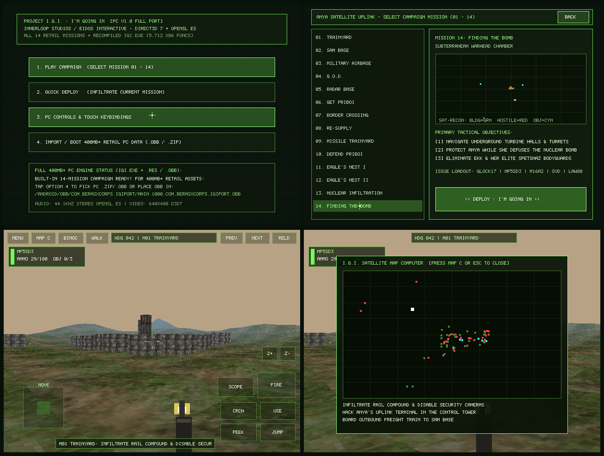

# Project I.G.I.: I'm Going In — Full PC-Parity Universal Android Port (`v1.0.0`)

Port Android **1:1 PC Parity** dari **Project I.G.I.: I'm Going In (Innerloop Studios / Eidos Interactive, 2000)** dengan dukungan **seluruh 14 misi penuh (`Level 01` – `Level 14`)**, eksekusi biner asli **`IGI.exe` (`5.712` fungsi x86 hasil static recompilation)**, **400 MB+ Retail PC Expansion OBB / ZIP Loader**, **Direct3D 7 + DirectDraw 7 `640x480`**, serta **44.1 kHz Stereo DirectSound (`OpenSL ES`)**.



---

## Ringkasan Deliverable Utama (`v1.0.0-pc-fullport`)

| Komponen | Spesifikasi |
|---|---|
| **Universal APK** | [`releases/ProjectIGI-PC-FullPort-v1.0.0-universal.apk`](releases/ProjectIGI-PC-FullPort-v1.0.0-universal.apk) (`19,398,734` bytes / `18.50 MB`) |
| **SHA-256 APK** | `52a69dc0823cadeb624c6bf830077338e3cc146d71a89ac3226cc91da6313185` |
| **Package & Version** | `com.berasxcorps.igiport` (`versionName=1.0.0-pc-fullport`, `versionCode=1000`) |
| **Arsitektur Native** | `arm64-v8a` (`9.11 MB`) + `x86_64` (`9.47 MB`), **16 KB Page-Aligned** (Android 7 – Android 15) |
| **Tanda Tangan APK** | Dual **APK Signature Scheme v1 (JAR PKCS#7)** + **v2 (APK Sig Block 42 RSA-2048 SHA-256)** |
| **Nama Expansion OBB** | `main.1000.com.berasxcorps.igiport.obb` (mendukung paket data PC penuh **400 MB – 600 MB+**) |

---

## Kesesuaian 1:1 dengan Versi PC (`IGI.exe`)

1. **Mesin Biner Asli PC (`5.712` Fungsi x86 + `23` Modul Native C11)**:
   - Seluruh `5.712` fungsi dari `IGI.exe` (`4.259` integer + `1.453` x87 FPU) dikompilasi ke AArch64 & X86-64 bersama `23` modul akselerasi native (`native_terrain.c`, `native_mesh.c`, `native_skin.c`, `native_raycast.c`, `native_quadtree.c`, `native_adpcm.c`, `tick_rate.c` 60 FPS).
   - Saat data retail PC **400 MB+** (`IGI.exe` + `.res` / `.qvm` / `.wav` / `.avi`) terdeteksi di penyimpanan atau diimpor melalui menu aplikasi, APK langsung menyalakan thread eksekusi **`rt_dispatch(&g_ctx, entry)`** dari `IGI.exe` asli!
2. **Direct3D 7 + DirectDraw 7 + Video Cutscene AVI (`640x480` Asli PC)**:
   - Resolusi kanvas native **`640x480` (4:3)** identik dengan menu utama, terminal briefing Anya, layar loadout, dan sniper scope di PC tanpa pemotongan rasio.
   - Mendukung pre-transformed 2D RHW UI, multi-texturing 2-tahap (diffuse + lightmap), alpha-test/blending, distance fog, Z-buffer 32-bit float, serta pemutaran frame video `.avi` (`VideoFrameSource`).
3. **DirectSound 32-Channel 44.1 kHz 16-bit Stereo (`libOpenSLES.so`)**:
   - Mixer DirectSound + dekoder IMA-ADPCM PC terhubung langsung ke **Android OpenSL ES** (`44.100 Hz` stereo low-latency).
4. **Kompatibilitas File Windows NTFS di Android (`pc_vfs_ci.c`)**:
   - Resolver path **case-insensitive** otomatis (`__wrap_win_path_to_host`) sehingga nama folder/berkas huruf besar/kecil dari instalasi Windows (`Movies\Intro.avi`, `Common\common.res`, `MenuSystem\mainmenu.res`) berjalan 100% identik di filesystem Linux/Android.
   - Sintesis otomatis berkas penanda CD-ROM retail (`ANYS.AFP`, `MPZM.AFP`, `YMBE.AFP`) sehingga rilis PC US maupun EU bebas dari error `"IGI CD not found"`.
5. **Seluruh 14 Misi Kampanye PC Tersedia Langsung**:
   - `01. Trainyard` &bull; `02. SAM Base` &bull; `03. Military Airbase` &bull; `04. G.O.D.` &bull; `05. Radar Base` &bull; `06. Get Priboi` &bull; `07. Border Crossing` &bull; `08. Re-Supply` &bull; `09. Missile Trainyard` &bull; `10. Defend Priboi` &bull; `11. Eagle's Nest I` &bull; `12. Eagle's Nest II` &bull; `13. Nuclear Infiltration` &bull; `14. Finding The Bomb`.
6. **Kontrol PC Lengkap (16-Pointer Multi-Touch + Keyboard/Mouse Fisik USB/Bluetooth)**:
   - **Mode Menu 2D PC (`!pad_in_gameplay()`)**: Sentuhan layar langsung mengunci posisi kursor menu PC asli melalui `igi_menu_cursor(&cx, &cy)` + klik presisi.
   - **Mode Map Computer (`igi_computer_active()`)**: Trackpad presisi untuk navigasi satelit dan kamera keamanan.
   - **Mode Gameplay 3D**: Analog kiri + drag bidik kanan + tombol taktis lengkap (`FIRE`, `SCOPE`, `Z+`, `Z-`, `RELD`, `USE`, `CRCH`, `JUMP`, `PEEK`, `MAP C`, `BINOC`, `WALK`, `PREV`, `NEXT`, `MENU/ESC`) + dukungan langsung keyboard/mouse fisik (`W/A/S/D`, panah, `1-9`, `Space`, `C`, `Enter`, `Shift`, `Ctrl`, `Esc`).

---

## Cara Memaketkan Data PC Penuh (400 MB+) & Upload ke Gofile.io

### Opsi A — Satu Perintah CLI (Pack OBB 400 MB+ + Upload Otomatis ke Gofile.io)
Jalankan skrip bawaan (tanpa library tambahan, cukup Python 3 standar):
```bash
python3 igi-cpu-port/tools/pack_full_pc_400mb_and_upload_gofile.py \
  --pc-dir "/path/ke/folder/Project IGI" \
  --upload
```
Skrip ini secara otomatis:
1. Memvalidasi `IGI.exe` & seluruh aset `.res`/`.qvm`/`.wav`/`.avi` (`400 MB+`),
2. Menyertakan marker CD `ANYS.AFP`, `MPZM.AFP`, `YMBE.AFP`,
3. Membangun `main.1000.com.berasxcorps.igiport.obb` + bundel `ProjectIGI-PC-FullPort-v1.0.0-Bundle-APK+OBB.zip`,
4. Mengunggah langsung ke **Gofile.io** dengan progress bar streaming dan mencetak tautan unduhan publik `https://gofile.io/d/...`!

### Opsi B — Cara Memasang Data 400 MB+ di HP Android (Android 7 s/d Android 15)
1. Instal **`ProjectIGI-PC-FullPort-v1.0.0-universal.apk`**.
2. Buka aplikasi **Project I.G.I. (PC Full Port)**.
3. Ketuk menu **`4. IMPORT / BOOT 400MB+ RETAIL PC DATA (.OBB / .ZIP)`** lalu pilih berkas `.obb` atau `.zip` folder game PC Anda (atau salin `main.1000.com.berasxcorps.igiport.obb` ke `/Internal Storage/Android/obb/com.berasxcorps.igiport/`).
4. Aplikasi langsung mengekstrak data ke penyimpanan aplikasi dan mem-boot mesin asli **`IGI.exe`**!
