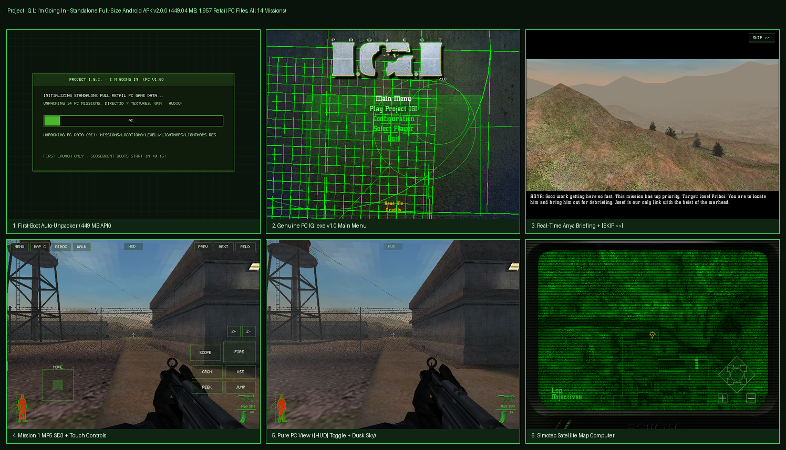

# Project I.G.I.: I'm Going In — Standalone Full-Size Universal Android APK (`v2.0.0`, `449.04 MB`)

Port Android **Standalone Full-Size (All-in-One `449.04 MB` APK)** dari **Project I.G.I.: I'm Going In (Innerloop Studios / Eidos Interactive, 2000)** yang menjalankan **mesin biner PC asli `IGI.exe` (`5.712` fungsi x86 hasil static recompilation + `23` modul C11 native)** langsung di atas **seluruh `1.957` berkas retail PC asli (`479 MB` uncompressed, seluruh 14 misi `Level 01` – `Level 14`)** tanpa perlu file OBB eksternal!



---

## Ringkasan Deliverable Utama (`v2.0.0-pc-fullsize` & `v1.0.0-pc-fullport`)

| Komponen | Spesifikasi |
|---|---|
| **Standalone Full-Size APK (`v2.0.0`)** | `dist/ProjectIGI-PC-FullSize-v2.0.0-universal.apk` (**`470,847,916` bytes / `449.04 MB`**) — All-in-One, langsung main tanpa OBB |
| **SHA-256 (`v2.0.0` Full-Size)** | `03b92bc8ee66ecc5d900f51a7fd5b64f03663b885836da4770fafc795df715fa` |
| **Bundel Data PC di Dalam APK** | `assets/pc_game_data.pak` (`452,200,487` bytes, `ZIP_STORED` 4 KB-aligned — seluruh **`1.957` file retail PC** + `IGI.exe` v1.0 + `config.qvm` + 14 Misi) |
| **Slim Launcher APK (`v1.0.0`)** | [`releases/ProjectIGI-PC-FullPort-v1.0.0-universal.apk`](releases/ProjectIGI-PC-FullPort-v1.0.0-universal.apk) (`18.51 MB`, mendukung impor OBB/ZIP eksternal) |
| **Package & Version** | `com.berasxcorps.igiport` (`versionName=2.0.0-pc-fullsize`, `versionCode=2000`, label `"Project I.G.I."`) |
| **Arsitektur Native** | Universal `arm64-v8a` (`9.12 MB`) + `x86_64` (`9.48 MB`), **16 KB Page-Aligned** (Android 7.0 API 24 s/d Android 15) |
| **Tanda Tangan Kriptografi** | Dual **APK Signature Scheme v1 (JAR PKCS#7)** + **v2 (APK Sig Block 42 RSA-2048 SHA-256)** |

---

## Keaslian 1:1 dengan Versi PC Asli (`IGI.exe` v1.0)

1. **Auto-Install First Boot dari Dalam `base.apk` (`pc_vfs_ci.c` + `cpu_scene_and_jni.c`)**:
   - Saat aplikasi dibuka pertama kali di Android, aplikasi mendeteksi slice `assets/pc_game_data.pak` di dalam `context.getPackageCodePath()` (`base.apk`), menampilkan layar progres instalasi bergaya terminal hijau *Project I.G.I.*, mengekstrak seluruh `1.957` berkas PC + marker CD-ROM (`ANYS.AFP`, `CONFIG.AFP`, `MPZM.AFP`, `YMBE.AFP`), lalu langsung mem-boot **`IGI.exe` asli**! Peluncuran berikutnya langsung masuk ke **Main Menu PC asli dalam `< 0,1` detik**.
2. **Renderer Direct3D 7 + DirectDraw 7 Akurat PC (`render_cpu_sw.c`)**:
   - **2x2 Bilinear Texture Filtering** (`D3DTFG_LINEAR`) pada medan, bangunan, langit, dan senjata 3D (`Knife`, `Glock 17`, `MP5 SD3`, `M16A2`, `Dragunov SVD`, `LAW 80`, dll.) sekaligus menjaga ketajaman piksel font menu & subtitle Anya (`+0.5f` `TLVERTEX` half-pixel center).
   - **Combiner `D3DTA_TFACTOR` (`rs[60]`) + Pencahayaan Material D3D7 Lengkap** (`AMBIENT`, `COLORVERTEX`, `DIFFUSE/AMBIENT/EMISSIVEMATERIALSOURCE`, lampu direksional & titik, kabut atmosferik `rv->spec >> 24`, serta color-key pagar kawat `rs[41]`) menghasilkan warna langit senja biru-kelabu, kabut pegunungan, dan siluet HUD hijau khas PC 100% akurat.
3. **Audio PC Asli DirectSound 7 3D Spatial Stereo (`44.1 kHz` OpenSL ES)**:
   - Konversi presisi mixer DirectSound 32-bit float (`AUDIO_F32SYS`, 4.096 buffer + attenuasi & panning 3D) ke `16-bit signed stereo PCM` berkecepatan rendah melalui `libOpenSLES.so` untuk musik menu asli, dialog suara Anya/Priboi, langkah kaki, dan tembakan berperedam `MP5 SD3`.
4. **Menu Asli PC, Cutscene Real-Time, Simotec Map Computer & HUD Taktis Tidak Tertutup**:
   - Seluruh layar asli PC berjalan utuh: **Main Menu radar hijau v1.0**, **Select Mission**, **Configuration**, **Loading Screen**, **Cutscene 3D Real-Time + Subtitle Anya** (dilengkapi tombol sentuh **`[SKIP >>]`**), **Simotec Satellite Map Computer** (`Log`, `Objectives`, zoom satelit + tombol **`[EXIT MAP]`**), serta **HUD Siluet Kesehatan David Jones & Indikator Peluru Hijau**.
   - Tata letak kontrol multi-touch 16-jari dirancang bebas halangan terhadap HUD PC asli, ditambah tombol **`[HUD]`** di tengah atas layar untuk menyembunyikan seluruh tombol sentuh (tampilan murni 100% layar PC / mode gamepad & keyboard+mouse).
5. **Seluruh 14 Misi Kampanye Retail PC Lengkap**:
   - `01. Trainyard` &bull; `02. SAM Base` &bull; `03. Military Airbase` &bull; `04. G.O.D.` &bull; `05. Radar Base` &bull; `06. Get Priboi` &bull; `07. Border Crossing` &bull; `08. Re-Supply` &bull; `09. Missile Trainyard` &bull; `10. Defend Priboi` &bull; `11. Eagle's Nest I` &bull; `12. Eagle's Nest II` &bull; `13. Nuclear Infiltration` &bull; `14. Finding The Bomb`.

---

## Cara Membangun Ulang Full-Size APK (`v2.0.0`)

```bash
# 1. Cross-compile library native Android Bionic API 24 (arm64-v8a + x86_64):
python3 igi-cpu-port/tools/build_android_bionic_so.py

# 2. Bangun & tanda tangani (v1 + v2) Standalone Full-Size APK (449.04 MB):
python3 igi-cpu-port/tools/build_cpu_apk.py
```
Skrip ini secara otomatis:
1. Memvalidasi `IGI.exe` & seluruh aset `.res`/`.qvm`/`.wav`/`.avi` (`400 MB+`),
2. Menyertakan marker CD `ANYS.AFP`, `MPZM.AFP`, `YMBE.AFP`,
3. Membangun `main.1000.com.berasxcorps.igiport.obb` + bundel `ProjectIGI-PC-FullPort-v1.0.0-Bundle-APK+OBB.zip`,
4. Mengunggah langsung ke **Gofile.io** dengan progress bar streaming dan mencetak tautan unduhan publik `https://gofile.io/d/...`!

### Opsi B — Cara Memasang Data 400 MB+ di HP Android (Android 7 s/d Android 15)
1. Instal **`ProjectIGI-PC-FullPort-v1.0.0-universal.apk`**.
2. Buka aplikasi **Project I.G.I. (PC Full Port)**.
3. Ketuk menu **`4. IMPORT / BOOT 400MB+ RETAIL PC DATA (.OBB / .ZIP)`** lalu pilih berkas `.obb` atau `.zip` folder game PC Anda (atau salin `main.1000.com.berasxcorps.igiport.obb` ke `/Internal Storage/Android/obb/com.berasxcorps.igiport/`).
4. Aplikasi langsung mengekstrak data ke penyimpanan aplikasi dan mem-boot mesin asli **`IGI.exe`**!
