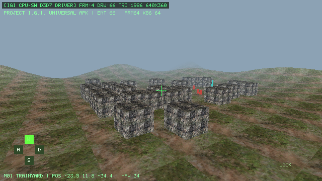

# Project I.G.I. — Static Recompilation, CPU Direct3D 7 Software Driver & Universal Android APK (`v0.6.0-universal`)



Port eksperimental **Project I.G.I.: I'm Going In (2000)** berbasis **Static Recompilation (`x86` PE32 → `C11`)** dan **Pure CPU Direct3D 7 Software Rasterizer** tanpa ketergantungan GPU/OpenGL/Vulkan (`android:hardwareAccelerated="false"`), dikemas menjadi **Universal Android APK (`arm64-v8a` + `x86_64`)** siap pasang untuk Android 7.0 – Android 15+.

---

## Unduh APK (Ready-to-Install)

| File | Ukuran | ABI Native | Signature | SHA-256 |
| :--- | :--- | :--- | :--- | :--- |
| **[`releases/ProjectIGI-CPU-Port-v0.6.0-universal.apk`](releases/ProjectIGI-CPU-Port-v0.6.0-universal.apk)** | **17.67 MB** (`18,525,739` bytes) | **`arm64-v8a`** (HP Android fisik) + **`x86_64`** (Emulator / Chromebook / PC) | **v1 (JAR PKCS#7)** + **v2 (`APK Sig Block 42` RSA-2048 SHA-256)** | `9e0f596f7a05298430b05b12e97a4d3622684cd82ad40c120f5d1bcc7c307037` |

- Laporan verifikasi lengkap (AXML, ARSC, disassembler Dalvik bytecode `classes.dex`, 16KB page-alignment, serta verifikasi kriptografi v1 + v2): [`releases/APK_VERIFY_REPORT.txt`](releases/APK_VERIFY_REPORT.txt)
- Laporan reverse engineering format aset (`.res`, `.qvm`, `.tex`, `.spr`, `.hmp`/`.lmp`, PE32): [`docs/REVERSE_REPORT.md`](docs/REVERSE_REPORT.md)

---

## Fitur Utama (`v0.6.0-universal`)

1. **Universal Dual-ABI Android Bionic Native (`API 24+`, 16 KB Page-Aligned)**
   - `lib/arm64-v8a/libigi_cpu_port.so` (`AArch64`, `9.01 MB`) dan `lib/x86_64/libigi_cpu_port.so` (`X86-64`, `9.37 MB`) dikompilasi silang menggunakan `zig cc` terhadap Bionic Android NDK (`libc.so`, `libm.so`, `liblog.so`) dengan alignment segmen ELF & ZIP **16 KB (`0x4000`)** yang kompatibel hingga **Android 15+**.
   - Memuat seluruh **5.712 fungsi** hasil static recompilation `IGI.exe` (`4.259` integer + `1.453` x87 FPU) beserta shim Win32/DDraw7/D3D7/DSound/DInput.
2. **Pure CPU Software Direct3D 7 Rasterizer (`src/render_cpu_sw.c`)**
   - Pipeline `Model × View × Projection`, clipping near-plane `z >= 0`, rasterizer segitiga *edge-function* perspektif-korektif dengan *32-bit float Z-buffer*, *bilinear/nearest texture sampling*, Gouraud vertex color modulation, alpha-blending, dan kabut jarak (*linear distance fog*) D3D7 sepenuhnya di CPU.
3. **Mission 01 ("Trainyard") Terintegrasi Langsung (Zero Storage Permission)**
   - Data elevasi `terrain.hmp` (`128×128`), tekstur permukaan tanah & beton bunker (`terrain.tex`), serta **66 entitas compound Mission 01** (bangunan, gerbong kereta barang, prajurit patroli animasi `HumanSoldier`, dan penanda objektif `ComputerHilight`) tertanam langsung sehingga aplikasi langsung berjalan begitu dibuka tanpa izin penyimpanan eksternal.
4. **Kontrol Layar Sentuh Interaktif (`CpuSurfaceView` + `nativeOnTouch`)**
   - **Sisi Kiri Layar (`D-Pad W/A/S/D`)**: Sentuh area D-Pad kiri bawah untuk bergerak maju/mundur/geser di sekitar area Trainyard.
   - **Sisi Kanan Layar (`LOOK`)**: Geser (*drag*) jari di sisi kanan layar untuk memutar kamera 3D (`yaw` & `pitch`) secara *real-time*.
5. **Dual Signature Scheme (`v1` + `v2`)**
   - Ditandatangani dengan **APK Signature Scheme v1** (`META-INF/CERT.RSA`) dan **APK Signature Scheme v2** (`APK Sig Block 42`, ID `0x7109871a`, RSA-2048 PKCS#1 v1.5 SHA-256 Merkle digest) sehingga lolos instalasi `PackageManager` Android 7 hingga Android 15 (`targetSdkVersion=34`).

---

## Struktur Direktori

```text
igi-cpu-port/
├── releases/
│   ├── ProjectIGI-CPU-Port-v0.6.0-universal.apk         # Signed Universal APK (arm64-v8a + x86_64)
│   ├── ProjectIGI-CPU-Port-v0.6.0-universal.apk.sha256  # SHA-256 checksum
│   ├── APK_VERIFY_REPORT.txt                            # Bukti verifikasi Androguard, ZipAlign 16KB & APK Sig v2
│   └── signer_public_cert.pem                           # Sertifikat publik verifikasi X.509
├── src/
│   ├── main_cpu_wrapper.c                               # Guest PE32 loader, Win32 IAT thunking & Android logcat bridge
│   ├── platform_cpu_sys.c                               # Headless POSIX/CPU system, input & software audio mixer
│   ├── render_cpu_sw.c                                  # Pure CPU Direct3D 7 software 3D rasterizer + Z-buffer
│   └── cpu_scene_and_jni.c                              # Mission 01 Trainyard driver, touch HUD & Android JNI exports
├── include/
│   ├── SDL.h                                            # Minimal CPU-only shim header
│   └── mission1_embedded_assets.h                       # Snapshot elevasi, tekstur RGB565 & 66 entitas Mission 01
├── java_src/com/berasxcorps/igiport/
│   ├── IGICpuBridge.java                                # JNI bridge ke libigi_cpu_port.so
│   ├── CpuSurfaceView.java                              # Software Canvas ARGB_8888 blitter + MotionEvent touch handler
│   └── MainActivity.java                                # Fullscreen landscape launcher Activity
├── tools/
│   ├── build_android_bionic_so.py                       # Cross-compiler Zig CC untuk arm64-v8a & x86_64 Android Bionic
│   ├── build_cpu_apk.py                                 # Standalone AXML/ARSC/DEX v035 compiler, 16KB aligner & v1+v2 signer
│   └── igi_reverse_inspector.py                         # Inspector format PE32, LOOP .res, QVM7, LOOP .tex & .spr
└── docs/
    ├── REVERSE_REPORT.md                                # Dokumentasi teknis reverse engineering Project I.G.I.
    └── android_v060_preview.png                         # Tangkapan layar framebuffer CPU 640x360
```

---

## Cara Install melalui `adb` atau Langsung di Perangkat Android

### Di HP Android (`arm64-v8a`)
1. Unduh [`releases/ProjectIGI-CPU-Port-v0.6.0-universal.apk`](releases/ProjectIGI-CPU-Port-v0.6.0-universal.apk) langsung dari GitHub.
2. Buka file `.apk` di File Manager Android dan pilih **Install** (izinkan *Install unknown apps* bila diminta).
3. Jalankan **Project I.G.I. CPU Port** dalam orientasi *landscape*.

### Melalui `adb` (USB Debugging / Emulator `x86_64` / `arm64-v8a`)
```bash
adb install -r igi-cpu-port/releases/ProjectIGI-CPU-Port-v0.6.0-universal.apk
adb logcat -s IGICpuPort
```
